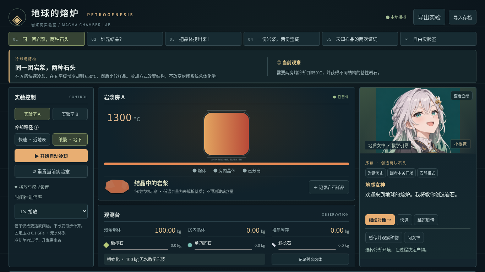

# 地球的熔炉 · Petrogenesis

一个中文单人岩浆房实验与解谜原型。没有后端、账号或外部 API；五个关卡使用同一确定性教学核心，另有真实 MELTS 离线研究档案，实验与样品保存在浏览器本地。



## 本地运行

需要 Node.js 22 或更高版本（当前验证：24.19.0）。

```bash
npm ci
npm run dev
```

浏览器打开终端显示的开发服务器地址。验证与生产构建：

```bash
npm test
npm run build
```

云环境若默认 npm 缓存不可写，可用 `npm ci --cache /workspace/.npm-cache`。五个关卡可直接切换，不强制考试或按顺序解锁。自动冷却可以暂停；重新开始使用“重置当前实验室”。切换关卡会重置当前两房，先记录要保留的样品。

## 模块

- `src/data.ts`：统一氧化物基准、教学合成初始组成、矿物代理端元与模型版本。
- `src/engine.ts`：纯逻辑初始化、冷却、结晶、有限交换、分离、历史快照、质量平衡和描述性岩石分类。
- `src/levels.ts`：原四关、新证据关卡与沙盒的可用操作、提示及基于状态的目标检测。
- `src/experiments.ts`、`src/research.ts`：完整状态分支、类型化命令、确定性重放、证据与多解目标判定。
- `src/science/`：独立MELTS资料包、逐节点审计与受约束回放UI。
- `scripts/science/run_melts.py`：调用官方原生引擎生成资料包，不随游戏分发引擎。
- `src/visuals/`、`src/assets/`：按库存绘制样品与原创角色美术。
- `src/storage.ts`：版本化存档、导入检查与初始状态。
- `src/main.tsx`：控制器、SVG 岩浆房、图表、观察、样品记录和对比。
- `src/engine.test.ts`：四关可达路径、质量守恒、非负、确定性、交换分离、存档和边界测试。

## 已实现玩法与可复现示例

| 模式                   | 目标与可行操作                                                                                                                              |
| ---------------------- | ------------------------------------------------------------------------------------------------------------------------------------------- |
| A 同一团岩浆，两种石头 | A房快冷到650°C；B房慢冷到650°C。得到玄武质与辉长质结构；两房总体化学和矿物计算相同。分别记录样品，在记录页勾选两份比较。                    |
| B 谁先结晶             | 从1300°C逐步降至1000°C；观察首次事件和三种矿物曲线。                                                                                        |
| C 把晶体捞出来         | 两房均到1100°C；A房分离全部橄榄石与辉石，两房继续到1000°C。熔体 SiO₂ 相差至少0.2个百分点。                                                  |
| D 一份岩浆，两份宝藏   | 到1150°C，分离全部橄榄石（此阶段辉石尚未出现），再到1050°C。分离产物≥5kg、早期矿物≥60%；熔体≥15kg且SiO₂比初始高≥1个百分点。记录堆晶与熔体。 |
| E 未知样品的两次证词 | 先提交650°C快慢冷岩石；再提交1000°C保留／分离液相及候选路径。自动验证两种解：1100°C分离100%橄榄石与辉石；或1150°C分离75%，均继续冷却至1000°C。 |
| 自由实验               | 两种教学样品、自定义JSON、任意单向冷却路径、矿物分离、取样、存档导入导出、实验对比。                                                        |

以上路径由自动化测试直接调用模拟器验证；目标检测依据实际结果，新证据关卡还重放日志核对记录来源。第四关阈值是教学挑战条件，而非自然界成矿或岩石分类的标准。

### 导入初始样品

自由模式中选择“导入组成 JSON”。总和必须为100 wt.%、各项有限且非负。source 是来源说明，不能省略。导入文件与完整存档是两种不同格式。

```json
{
  "source": "教学合成样品，非真实采集",
  "composition": {
    "SiO2": 49,
    "TiO2": 1,
    "Al2O3": 16,
    "FeO": 10,
    "MgO": 8,
    "CaO": 12,
    "Na2O": 3,
    "K2O": 1
  }
}
```

## 科学模型：teaching-proxy-1.0

**这是透明的教学代理，不是已校准的热力学求解器，此教学核心与独立的 MELTS 研究档案分开运行。** 所有初始样品是教学合成数据；玄武质样品来自任务书的暂定组成。第二个演化样品也为教学合成。矿物端元与所有结晶参数属于教学近似/暂定参数，不是真实观测或实验拟合结果。使用固定0.1GPa无水氧化物基准，总铁以FeO*计，初始质量100kg。

结晶运算每次最多降温5°C。以当前液相氧化物质量百分数计算三个代理起始温度（°C）：

- 橄榄石：1120 + 10 MgO + 2 FeO
- 单斜辉石：1040 + 6 CaO + 3 MgO
- 斜长石：1030 + 4 Al₂O₃ + 3 CaO − 2 Na₂O

权重为 `clamp((起始温度−T)/100,0,1)` 乘以对应MgO/8、CaO/12、Al₂O₃/16。每5°C结晶预算为 `min(液相质量×0.035,1.25kg)`，按权重分配；每个矿物的实际量再由当前可用组分限制。不是固定温度必然生成矿物：缺失必要组分就不能生成。微小非5°C步长按比例处理；不同分段方式可能有数值步进差异，应使用5°C整数步长复现实验。

矿物氧化物端元（wt.%；其余为0）：

| 矿物     | SiO₂ | Al₂O₃ | FeO* | MgO | CaO | Na₂O |
| -------- | ---: | ----: | ---: | --: | --: | ---: |
| 橄榄石   |   40 |     0 |   16 |  44 |   0 |    0 |
| 单斜辉石 |   51 |     4 |    8 |  15 |  22 |    0 |
| 斜长石   |   52 |    30 |    0 |   0 |  14 |    4 |

每一氧化物以kg为真实账本，不在质量转移时随意归一化。显示wt.%仅由该库存绝对组分质量除以库存总质量得到。结晶从液相转移到房内固相；分离从房内固相转移到分离固相。全系统质量与每种氧化物误差要求低于10⁻⁸kg。

保留晶体每5°C有1.5%物质返回液相，再根据当前组成重新结晶，作为晶体—熔体有限交换的简化代理。**这个交换比例未经实验校准，不代表降温时所有晶体都会真实溶解，也不是平衡结晶模型。** 分离晶体不再交换。分离瞬间液相组成不变；其后继续冷却时两条路径才会不同。此明确假设使封闭保留与分离路径可比较，未来应替换成可追溯的相平衡/反应模型。

快冷和慢冷只影响结构标签与晶体示意大小，不影响化学运算。路径超过70%的冷却子步为慢冷时显示粗粒，否则细粒；分阶段路径会保留记录，但暂不预测真实形核、斑晶尺寸或斑状结构。

终点650°C未成晶组分记为未解析基质，不能据此预测玻璃含量，保留在原液相账本供分析；这时“残余熔体”标签指未成晶组分，不表示650°C仍存在真实液体。不凭空把Ti、K等塞入未支持的矿物。样品分类需满足房内总体SiO₂45–53wt.%、MgO+FeO≥12wt.%、CaO≥7wt.%、晶体>5kg且有斜长石，才结合结构标记玄武质或辉长质岩石；其余用描述性名称。不是正式TAS/QAPF判别。

取样是非破坏性库存快照，**不是再次扣质量**；多份记录可能代表同一物质在不同时间，不能相加当成独立物理产物。分离操作才实际移动物质。历史图中矿物质量包含房内及已分离库存。可见晶体颗粒是质量比例示意，不代表真实单晶数。

## 验证和边界

`npm test` 验证每关至少一条可达路径，逐步混合分离路径的组分守恒与非负，快慢冷化学一致，分离瞬间的液相不变，成分影响结晶，确定性、存档往返与重置。`npm run build` 包含严格TypeScript检查及生产构建。

教学沙盒仅支持冷却；升温、部分熔融、压力路径、构造、沉积、成矿、微量元素、真实数据库检索和正式岩石分类不在本版本范围。MELTS档案保留官方样品的H₂O及分别给出的FeO/Fe₂O₃，固定压力和封闭氧边界，不开放任意含水量或红氧控制。没有将未来关卡作为无功能界面展示。

下一步优先由岩石学专家审核MELTS节点与适用域，诊断分离路径在1100°C的非收敛，再扩展经过验证的分支。安排零基础玩家试玩并记录交互障碍；斑状结构应在晶体世代模型可验证后再加入。

## 浏览器交互测试

```bash
# 当前云环境已有 /usr/bin/chromium；其他机器首次运行时：
npx playwright install chromium
npm run test:e2e
```

Playwright 用例通过真实页面操作完成五关，验证样品对比、刷新恢复和重置，并检查浏览器运行时错误。系统 Chromium 不存在时使用 Playwright 安装的 Chromium。浏览器测试与 Vitest 核心测试分开运行。

## 下载与桌面发布

发布下载入口：GitHub 仓库的 Releases。网页离线版为单个HTML（所有JS/CSS已内联），也提供附操作说明的ZIP。下载后在现代浏览器中打开，无需Node.js。

Windows桌面版采用Electron，提供64位便携EXE；无需安装。未签名，不包含自动更新。网页和桌面本地存档独立，可用导出/导入JSON迁移。详细游玩说明见 `PLAY_OFFLINE.md`。

```bash
npm run build
npm run package:web
# Windows桌面包，推荐在Windows机器或GitHub Actions中构建
npm run package:win
```

产物位于 `release/`（不提交到源码Git历史）。发布流程 `.github/workflows/release.yml` 在推送 `v*` 标签时自动运行核心测试、生成网页与Windows包、生成SHA256校验清单并上传GitHub Release。也可手动运行工作流获取Actions构建产物；手动运行不创建正式Release。

当前云环境的受管Chromium禁止直接打开file://，因此单文件包以本地静态服务验证；Windows程序实际运行需在Windows测试，Linux交叉构建成功不能代替Windows运行验证。

## 女神引导者与叙事教学（v0.2）

四个现有关卡现在都有开场、观察反馈、科学演出、主动失败检查与通关收尾。第一关包含可选开场回答、两房冷却、第一块真实样品反馈、结构与化学并列对比和角色总结。女神是过程操控者，不提供直接合成岩石的按钮。原有四关、沙盒、样品记录与化学分析全部保留。

### 游玩方法

- 女神面板位于实验区右侧（窄屏移至下方），支持继续、分支选择、快进、跳过与历史回看。已接入原创现代日系AI生成立绘与五种对话表情，可点击“查看立绘”。尚无配音、口型同步或Live2D。
- 可随时按原控制面板实验，不必读完剧情。跳过剧情不跳过实验、不修改质量，也不撤回已经执行的操作。任务卡和按钮说明始终可用。
- “暂停并观察矿物”暂停自动演化，查看所选矿物的真实库存及温度—矿物质量曲线。观察后由玩家手动继续，避免剧情意外启动实验。
- 点击“问女神”展开“现象提示”“变量提示”“原理解释”三层帮助。“检查研究目标”描述当前缺口；连续三次同类检查时提供进一步解释的选项，不推断玩家一定持有什么错误观念。
- 时间推进倍率只改变执行间隔；1×与4×每步都推进同样的10°C，并调用同一核心的5°C子步。快慢冷路径与播放倍率是两个不同概念。
- 两房路径对比支持同时显示液相SiO₂随温度变化，以及实际产物、结构和房内总体组成。分离演示显示操作前后的液相、固相与堆晶库存及各氧化物转移量；分离瞬间液相组成不变，后续变化才取决于实际路径。
- 自由实验不自动触发长对话。也可全局启用安静模式；主动求助仍然可用。已触发的科学事实按关卡去重，不会因反复冷却或重置不停复述。
- 叙事游标、一次性事件、对话历史、失败计数及安静设置与科学实验一起保存、导出和导入。旧v0.1存档会自动补入叙事进度；已看过的开场在重载后不会重播，主动“回看本关开场”除外。

### 独立模块

| 模块                       | 责任                                                                                  |
| -------------------------- | ------------------------------------------------------------------------------------- |
| `narrative/characters.ts`  | 说话人、表情与动作类型，后续可替换角色资源                                            |
| `narrative/dialogue.ts`    | 类型化节点、下一节点、选择分支、明确的观察请求与纯推进逻辑                            |
| `narrative/scripts.ts`     | 五关中文开场、喜剧与通关脚本；语言目录预留替换入口                                    |
| `narrative/actions.ts`     | 冷却、步进、时间推进、分离与观察权能；前提检查，调用原Simulation Engine，返回明确错误 |
| `narrative/science.ts`     | 从真实状态计算分离证据、矿物证据、实验对比及未达标原因                                |
| `narrative/events.ts`      | 基于状态差异的条件匹配、优先级、去重、队列、历史及存档验证                            |
| `narrative/director.ts`    | 纯可视化计划：打开对应面板、信息深度和高亮；不持有或修改科学状态                      |
| `narrative/Narrator.tsx`   | 对话与现代日系立绘、快进/跳过/历史、显式研究操作                                          |
| `narrative/Comparison.tsx` | 两间实验室的真实路径叠加与总体化学对比                                                |

脚本只能请求类型化操作，不能任意赋值温度、质量或组成。当前脚本请求仅使用无副作用的矿物观察；玩家冷却与分离也全部经过适配器。所有自动剧情由实际前后状态触发；未达标通过玩家主动检查反馈，不会将尚未结束的实验擅自判为失败。玩家主动求助立即替换当前演出；重要通关事件优先于普通发现。被打断和跳过的台词仍可在历史中查看。历史包含分支脚本文本，并明确标记，避免误认为所有分支都曾实际说出。

科学解说的数字在事件发生时解析并随场景保存；证据区明确标为“事件时数据快照”，不会把历史数值冒充当前读数。实时图表和库存始终读取当前模拟状态。对话演出与科学过程不共享计时器：跳过、快进和表情变化不影响模型运算。

### 已实现范围与边界

- 四关均有至少一处角色互动、科学面板联动、状态检查和通关反馈；已为第一关增加真实浏览器叙事闭环测试，其余三关保留原可达性与浏览器通关回归。
- 新测试覆盖全部脚本分支目标、权限和库存前提、解说的质量关联、事件去重、自由实验安静行为、重复失败检查、存档迁移与剧情跳过。
- 关系成长通过预编写对话体现，未实现好感度数值或开放式生成剧情；不调用外部LLM或联网服务。当前仅中文，语言目录为未来本地化入口。
- 高级过程仅预留 `FutureProcess` 类型，尚不执行构造伸展、地幔上涌、热异常、岩浆侵位、减压/流体助熔、混合、抬升剥蚀或海盆演化。没有虚假的可执行按钮。
- 未添加P–T或P–T–t等缺乏当前模型支持的科学图。底层科学近似与适用边界保持不变，女神也会说明有限交换代理而非精确热力学预测。

下一步优先改进：正式角色立绘与更细致的矿物局部镜头；用受约束的实验或相平衡数据替换结晶代理后，再扩展压力与熔融叙事。所有新增过程应首先通过适配器与质量守恒回归测试。


## v0.3：证据关卡与真实科学档案

新关“未知样品的两次证词”要求两组实际对照记录和一条与报告相容的路径，不是选择题。报告由教学引擎生成，温度1000°C，比较液相SiO₂与CaO。采用CaO是因为当前代理在这一阶段MgO通常已接近零，CaO更能约束不同路径；区间仅是谜题容差。判定要求同起点、同终温、相同库存类型，并重放操作验证分离瞬间液相不变、继续冷却后差异出现。至少两条化学操作不同的成功路径由测试验证。

记录样品后，选择“从此记录分成两房”即可从完整库存继续实验；不会覆盖原记录。自动冷却的每步同样进入日志。v0.1/v0.2旧存档仍可导入；旧记录缺乏命令日志，能比较和分支，但不能伪装成原历史可重放的证据。研究板随存档保存。样品面积与容器高度是质量示意，不是矿物体积或真实晶粒预测。

“MELTS研究档案”预装两条真实计算路径，浏览器完全离线读取：官方MORB教程输入、alphaMELTS 2.3.2、rhyolite-MELTS 1.0.2、500 bar、封闭氧、保留流体，1235–1110°C每5°C一个节点。保留全部晶体／每步分离全部固相各26个节点，记录可变矿物组成与完整库存。求解器只做平衡；分离由显式账本转移，避免重复扣除。浏览器每次载入重新审计质量和元素守恒，禁止超域动作或用旧代理补算。

两条路径在当前Linux环境独立进程复算后输出完全一致，最大元素误差约7.26×10⁻¹⁰kg，低于工程门槛10⁻⁶kg。扩展分离路径在1100°C出现不收敛，失败日志和最后有效帧已保存；因此首批公开档案止于1110°C，不能据此声称全温区都可靠。保留路径曾成功算至1000°C，但首批UI只显示双方共同验证的范围。这是计算和守恒验证，尚未替代独立的实验岩石学精度验证。

详见 [科学复现与验证记录](docs/science/VALIDATION.md)。普通安装、游玩和测试无需下载求解器。当前40项单元测试、5项Playwright交互测试通过；Windows EXE由CI打包，仍需在真实Windows桌面实际试玩。尚未进行零基础用户测试、配音、晶粒动力学、任意MELTS自由分离或GEOROC/PetDB实时接入。
