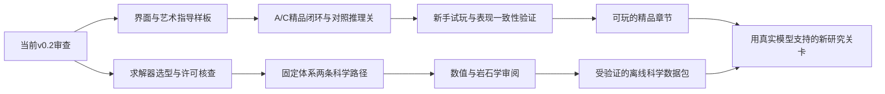

> 此文是v0.3实施前的研究计划。已交付范围、真实MELTS运行结果与未解决边界，以README和docs/science/VALIDATION.md为准。

# 《地球的熔炉》下一阶段改进研究

研究日期：2026-10-26。审查基线：v0.2.0，提交 `600195928bc0f5b1ab676286a37f6b83329ae2b8`。

本文是设计与技术决策建议，不代表这些功能已经实现、试玩通过或MELTS已经接入。本次只新增研究文档，不改动游戏运行代码、不发布新版。

## 1. 推荐决策

下一版应追求一个 **20–30分钟、能独立成立的精品实验章节**：打磨A/C两关，增加一个需要对照实验的推理关卡；同时用一个小型科学可行性原型验证MELTS路线。暂不同时推进十二关、3D、全配音、Live2D和在线热力学服务。

建议优先次序：

1. 澄清当前模型最容易误导的现象与终点标签。
2. 建立统一美术语言，改造首屏、操作反馈、标本获取和实验比较。
3. 用更好的实验问题和条件对话增加趣味，避免以增加台词长度代替设计。
4. 验证离线生成的科学路径，成功后再让它支撑新机制。
5. 小规模导入有授权与出处的真实样品档案；以后再考虑实时求解。

“独立游戏制作标准”在这里具体化为：清晰的艺术指导、可读且一致的交互、可感知的行动后果、能被玩家发现的规则、可靠的存档与发布、经过实际试玩的教学节奏。没有一套可凭功能数量直接达成的统一行业认证。

## 2. 当前版本真正的短板

| 代码现状 | 影响 | 处理建议 |
| --- | --- | --- |
| `src/main.tsx`把导航、任务卡、完整女神面板、三列实验区和分析区纵向排列 | 普通笔记本上需要滚动才能串起一次操作和解释 | 岩浆房/样品成为主舞台，分析和长对话按需展开 |
| `Chamber`用固定分布的同形菱形表示晶体，记录卡主要是文字 | 操作有数值结果，缺少“我得到了一件标本”的满足感 | 独立岩石外观、收集盘、短动画、与真实库存对应的样品卡 |
| `src/levels.ts:66`只要求三种矿物质量均超过0.1kg | B关直接降到低温也能完成，未形成观察与推断的问题 | 重构研究目标；不以点击观察次数或背顺序代替理解 |
| C关任务提示直接给出约1100°C的方案 | 玩家容易照配方而非探索 | 默认只给目标与现象，具体路径留到主动提示 |
| `narrative/director.ts`目前主要生成标签页和信息深度 | 女神“指向证据”的演出仍弱 | 统一实验游标、曲线标点、前后库存流向、可中断观察镜头 |
| 当前矿物成分固定，起始温度与结晶预算是教学代理；保留晶体每5°C返回液相1.5% | 守恒成立不等于真实相平衡；更精美的画面可能放大可信度误判 | 保留教学标识，进行真实模型对照，不把代理参数改名成热力学结果 |
| `engine.ts:217`把全部未成晶组分作为glass返回；快慢冷共用化学路径 | 慢冷终点的“玻璃比例”尤其不能当真实预测 | 优先标为“未解析基质/模型未分解组分”；只有有依据的淬火近似才显示玻璃解释 |
| `Snapshot`只有图表统计量，没有完整相组成库存 | 图表历史不能直接当可逆存档 | 增加类型化命令日志；用初始状态+操作序列确定性重放，或使用完整检查点 |

这些问题不要求推倒重来。现有权能适配、剧情去重、样品State快照与质量账本仍有价值。需要逐步拆分大型主组件，并建立可替换的模型后端接口。

## 3. 美术与界面：先做一套完整语言

### 视觉方向

建议保留“冷色地质实验空间 + 温暖熔体 + 手绘研究笔记”的辨识度。参考优秀作品的设计原则，而不复制其素材与外观：

- 《Opus Magnum》：运行、复盘、比较不同解法的满足感。
- 《Strange Horticulture》：标本和研究记录作为可操作的物件。
- 《Chants of Sennaar》：先给现象和语境，让玩家自己建立解释。

首轮资产预算控制为：一张正式女神半身立绘、5–7个表情和少量指向动作；一个实验室背景；三类矿物图形；玄武质、辉长质与堆晶样品示意；冷却、结晶、分离、取样四类短反馈及音效。暂不做复杂3D、全配音或角色骨骼动画。

矿物识别应同时使用形状、纹理、文字和颜色。识别配色不是天然颜色或真实偏光显微镜图像；需要明确区分“教学示意”和“实拍/显微照片”。当前模型给质量而非体积，面积与颗粒覆盖不能暗称真实体积分数。若以后加入密度换算，应记录密度假设。

### 交互布局

- 中央：岩浆房与可切换的岩石/显微示意舞台。
- 左侧：当前阶段最重要的一组操作，而非全部工具。
- 右侧：当前目标、最近证据、样品收集盘。
- 底部：可展开的实验时间线与分析抽屉；大图表在需要时占用舞台。
- 女神：平时侧边头像+一句短反馈；重要桥段展开对话区，不覆盖关键操作与数值。

默认求助只保留“问女神”，进入后再选择现象、变量、原理。普通反馈、观察解释和长剧情采用不同层级，避免每个事件都用同样大的对话框。研究条件及必要说明始终可找回。

以1366×768为首要验收尺寸，并检查1440×900及窗口缩放。关键正文以14–16px为设计起点；提供文字缩放、键盘焦点、减少动态效果与色觉冗余。分离操作应有预览、准确的分离质量与可恢复实验分支，而不是用不断弹确认框防误操作。

### 最值得打磨的一次操作

玩家选中橄榄石 → 显示本次将移走的kg与氧化物 → 晶体移入实体收集盘 → 库存流向图标出“液相没动，固相搬家” → 保留晶体组与分离组继续冷却 → 差异达到可分辨程度后才展示对比结论 → 获得带图像、条件与模型来源的标本卡。

所有动画消费模拟结果；帧率、画面暂停和跳过剧情都不承担科学计算。

## 4. 新关卡：增加研究问题，而不只增加按钮

| 关卡提案 | 玩家真正要做的事 | 支持条件与优先级 |
| --- | --- | --- |
| A/C精品改造 | 观察同源不同结构；设计保留/分离对照，解释即时不变与后续变化 | 最优先，复用现有能力 |
| 新关“未知样品的两次证词” | 为隐藏来源的教学样品设计对照，区分结构差异、初始组成和分离历史；提交样品与证据 | 下一版推荐，不依赖部分熔融；需完整检查点/重放和研究证据判定 |
| 新关“别把熔体都冻没了” | 在堆晶质量、矿物比例与剩余熔体之间寻找折中方案，允许多条可行路径 | 对D关的深化；先验证目标区域而非指定操作步骤 |
| 新关“石头里的两代晶体” | 分阶段冷却，形成可辨识的两代晶粒并解释其历史 | 延后；现有粗/细二分类不足，需独立且明确标注的晶体世代近似 |
| 新关“看似相同的证词” | 不同形成路径接近同一组观测；比较额外证据能排除什么、仍不能确定什么 | 科学路径验证后再做；避免宣称成分可唯一反演真实形成史 |

新推理关不做强制知识选择题。成功应依据有效对照、实际可检测差异、守恒和证据组合，而非是否点过规定顺序。来源隐藏只是一种研究情境，不要求玩家反推出模型本来就无法唯一确定的信息。

现有教学代理也不能保证任意新目标可达。每关在内容创作前先搜索可达状态：至少两条不同成功路径，以及一条看似合理的未达标路径；再写准确的反馈。标准通关不要求最优解，额外的材料利用率或实验效率只作为可选挑战，避免惩罚探索。

## 5. 对话：围绕玩家的一次猜想形成戏剧

每个桥段采用“主张 → 操作 → 证据 → 修正或确认 → 笑点回收”。人物不靠持续说俏皮话成立，而靠各自的判断、尺度与反应成立。

C关示例（这些是待实现的条件台词，不是现有内容）：

> 我：把这些晶体捞走，液体的成分应该立刻变吧？  
> 女神：先把“立刻”写进实验笔记。  
> ［玩家实际分离，显示前后库存］  
> 女神：固体搬走了。液相刚才没有参与这次搬家。  
> 我：所以不是你施法失败，是我把两本账看成了一本？  
> ［继续冷却，且实际差异已可分辨］  
> 女神：现在比较的，才是它们分开之后的历史。  
> 我：你是在等证据，不是在等我认错。  
> 女神：两件事并不冲突。

若差异尚未达到分析精度，就改为“目前还不能据此下结论”，绝不先演成功版。玩家也可一开始就判断正确；此时女神可以确认并提出更有挑战的观察，而不是让主角强行犯错。

建议为每个场景编写条件矩阵：触发证据、玩家已知内容、成功版、未达标版、反例版、跳过后的必要信息。数字、阈值、模型局限由科学解释模块提供；编剧负责节奏和人格。关系成长通过主角提出有效对照、主动质疑和保留不确定性体现，不急着加入好感度经济系统。

对话演出需增加“证据锚点”：台词指向具体实验、温度点、库存和模型版本；历史台词使用当时快照，不能指向已被另一轮实验覆盖的当前图表。保留中文脚本数据驱动结构，暂不必为了内容数量引入完整视觉小说引擎。

## 6. MELTS与真实数据库是两条不同的建设线

| 工具/资料 | 在游戏中的用途 | 不能自动提供的能力 |
| --- | --- | --- |
| MELTS系列、alphaMELTS | 指定组成、T/P、氧化还原/挥发分及过程条件下的相平衡、结晶等模型计算 | 真实晶粒尺寸、生长动力学、所有岩浆的精确预测或全部正式岩石分类 |
| GEOROC、EarthChem/PetDB等 | 有出处的岩石/矿物化学分析、真实样品档案及比较案例 | 某个样品完整而唯一的形成路径，或可任意查询条件的热力学模拟器 |
| 实验岩石学文献 | 检验相出现、液相组成、适用压力温度与误差 | 无条件覆盖全部游戏参数空间 |

推荐先精选少量样品，保留来源、样品ID、引用、分析类型与单位、Fe报告方式、是否归一化、挥发分/烧失量、蚀变/质量标记、原始记录与处理记录。数据应标明全岩/玻璃/矿物分析，不能混作同一种观测。未检出、未测量和零值要区分。

“把某条真实玄武岩记录导入”只提升初始条件的可追溯性，并不会使后续代理结晶成为真实预测。不能用全岩分析直接当液相组成却不说明假设，也不能把原始数据不加记录地归一化后丢掉原始基准。

## 7. 推荐的科学接入架构

### 首选：开发阶段离线计算，游戏读取受验证的数据包

`有出处的输入 → 指定版本求解器 → 质量/收敛/适用域检查 → 可追溯数据包 → 模型后端接口 → 游戏与解说`

理由：继续支持离线HTML和Windows；计算结果可审查、可复现；不把求解时间和失败直接转嫁给新手。开发工具可以使用Python或命令行，客户端仍用TypeScript，不必现在更换整体游戏引擎。

但是，**一条预计算的降温曲线不能支持任意晶体分离历史**。分离改变下一步参与平衡的组成；不同移除比例、矿物与温度可能产生新的路径。不能从“未分离路径表”插几次值，冒充新的分离计算。

首个科学样板只支持一个明确体系、一个固定压力、少量已验证过程分支。可选方案：

- 固定几组完整实验路径，作为“对照研究案例”，不假称任意操作沙盒。
- 明确限定可操作节点与分离选择，为每条可达分支实际重新计算，并保存节点后的完整状态。
- 以后才扩展为有参数范围和误差验证的代理模型，或可选的本地求解器后端。

显示层可平滑播放，但科学计算节点之间不能跨相出现/消失边界随意插值。若对守恒组分做插值，必须明确完整状态、库存和共同基准，验证非负、相边界、质量守恒及误差；不能各自插值矿物比例与液相wt.%后假装自动守恒。域外请求返回“本数据包不支持”，不默默外推或换用教学规则。

### 三种路线的权衡

| 路线 | 优点 | 代价与边界 | 决策 |
| --- | --- | --- | --- |
| 离线路径/有限分支数据包 | 可审查、可离线、启动快、网页与桌面一致 | 状态空间有限；分支数量增长；需授权与来源记录 | 首选原型 |
| 桌面版可选本地求解器 | 可做更多过程和参数探索 | 进程管理、不同平台、包体、求解失败、再分发义务 | 原型成功后评估，不先强制所有玩家安装 |
| 在线求解服务 | 统一运行环境，结果可缓存 | 服务成本、排队、隐私、网络依赖和部署维护 | 当前不推荐 |

不承诺直接把现有MELTS程序编译成浏览器WASM即可获得完整、可靠的网页求解器；在确认代码依赖、许可、计算成本与数值一致性之前，这是独立研发问题。

## 8. 科学接入必须先解决的接口问题

1. **组分基准。** 当前8组分无水总量不等于求解器的完整输入。FeO*不能唯一拆成FeO与Fe₂O₃；H₂O/CO₂缺失不能悄悄填成已知真实值。采用固定假设时必须明示。
2. **氧化还原与守恒。** 若引入可交换氧的fO₂边界，FeO与Fe₂O₃不再各自守恒。需要元素账本及氧交换项，或严格定义并审核的等效分析基准；不能把代理模型当前的“每种氧化物独立守恒”断言原封不动搬过来。
3. **单位。** 当前压力0.1的游戏含义为GPa；对接版本若使用bar，0.1GPa=1000bar。温度、质量单位、组分百分比基准都应由适配层显式换算。
4. **过程语义。** 平衡结晶、连续/分步分离、部分选择性移除不是同一个过程。后续求解必须使用正确的活动体系组成与保留相约束，已分离库存始终单独保存。
5. **矿物变化。** 当前只有三种固定矿物；真实求解可能出现更多相及可变固溶体。需要可扩展的相ID、逐相组成与质量，显示层可分组，但不能丢掉未显示的相来凑三矿物总量。
6. **模型覆盖。** 不同MELTS模型版本的适用体系与局限不同。不能仅按名字选择“最新版”，应按目标体系选型并记录已知缺陷。模型分支可包括原MELTS、rhyolite-MELTS、pMELTS等，但不是本轮全部实装清单。
7. **来源与存档。** 数据包至少保存求解器/模型版本、输入、边界条件、过程设定、来源引用、生成日志、质量检查、内容哈希和适用域。存档绑定后端与数据包版本；旧教学实验保持原模型，不能载入后静默重新解释。
8. **失败处理。** 不收敛、负相质量、缺失字段与域外请求都必须可识别。不得通过夹成零、改校验值或自动填目标产物来掩盖问题。

最小科学验收：在固定体系中重现一条封闭体系路径与一条明确的分离路径；对照官方示例或适当实验/发表算例；记录全相组成、质量和条件；验证模型适用域及收敛；获得外部岩石学审阅。守恒阈值必须由求解器精度与计量基准论证，不能直接照抄当前教学核心的10⁻⁸kg阈值。此后再验证有限分支或插值误差。

## 9. 授权、数据条款与研究证据边界

alphaMELTS官方仓库有许可证文件。已读取的许可说明包含alphaMELTS接口AGPLv3-or-later、所含xMELTS的BSD条款，以及GSL/Readline等依赖的GPL说明。AGPL允许商业使用和收费发布；问题是修改、组合、再分发或网络交互时分别有哪些义务，不能简单写成“不能用于商业游戏”。

离线运行工具生成数据、捆绑求解器到EXE、链接库、提供网络服务，应分别审核。独立输出数据不因为生成工具用了AGPL就当然全部变为AGPL，但数据本身、原始数据库、依赖和生成方式也要核对；“做成子进程”或“先预计算”不是自动免除许可义务的结论。落实方案前由具备相关能力的人审核具体发行版本和分发方式。

观测数据库还需独立确认使用条款、引用要求、批量下载/API政策与可再分发范围。公开可访问不等于允许把全库打进游戏。首批优先使用授权清晰、可引用、可随版本留存的少量精选资料，而非设计在线全库搜索。

外部证据与未决事项见文末资料表。部分官方站点受本环境访问限制，故未现场验证当前API、下载可用性或完整数据条款；本研究不把它们当作已经接通的依赖，也不声称运行过MELTS数值验证。

## 10. 分阶段范围、工作量与验收

工作量是当前小型TypeScript项目的工程人日量级估计，不是报价或交期承诺；依赖正式美术交付、科学审阅及外部软件问题。

| 阶段 | 交付物 | 初步量级 | 放行条件 |
| --- | --- | --- | --- |
| 决策样板 | 一屏高保真布局、一次分离演出分镜、科学接口与许可清单 | 3–5人日 | 明确风格与科学边界，无需先买大量资产 |
| v0.3精品章节 | A/C闭环、样品卡、统一时间线、一个推理关、条件对话与存档/重放 | 15–25工程人日；美术另计 | 新手试玩、可达性与表现一致性通过 |
| 并行科学试验 | alphaMELTS候选版本、固定体系的两条路径、原始输出及验证报告 | 5–10工程人日，另需专家审阅 | 科学、数值、许可三项都通过；失败则调整范围 |
| 后续科学体验版 | 经过验证的有限分支数据包、后端选择、来源档案与兼容存档 | 原型通过后再估，初步2–4工程周量级 | 全部允许操作均有正确支持，域外有明确反馈 |

如果只有一名开发者，应把“并行”理解为交错推进：界面验证时等待科学审阅，科学计算时处理不依赖结论的美术与文本；不要宣称一个人能同时完成两条全速开发线。时间紧时，v0.3先不承诺真实求解器，只保留清楚标注的模型与科学试验报告。

建议下一版的通过标准：

- 约5名零基础玩家中至少4名不读README即可完成A关核心循环；记录卡点和求助位置。这是小样本可用性门槛，不是统计学学习效果证明。
- 1366×768下目标、当前主操作、实验舞台和最近反馈可同时理解；不靠反复上下滚动串起一次分离。
- A/C及新推理关均有自动验证的可行路径；C与新关至少两条不同成功策略，失败反馈与实际原因一致。
- 跳过全部对话也能玩；读完对话不会错过关键观察；同一事实不反复刷屏。
- 视觉、样品、图表、历史证据与库存使用同一模拟状态；帧率与播放倍率不改变科学结果。
- 分支/重放、旧存档和不同模型版本有回归测试；桌面包进行实际Windows启动、下载、存档与更新检查，而非只有交叉构建成功。
- 科学试验独立出具“通过/不通过/未验证”，不能由游戏功能测试通过代替科学有效性验证。

最终建议：先使玩家愿意反复做实验，再让更真实的模型带来新的研究问题。美术、叙事和科学在同一个可玩的实验闭环里验收，避免三条路线分别堆功能、最后无法互相解释。

## 11. 外部资料

- alphaMELTS官方仓库（说明、版本及LICENSE入口）：https://github.com/magmasource/alphaMELTS
- MELTS官方站点：https://melts.ofm-research.org/
- GEOROC官方站点：https://georoc.eu/
- EarthChem官方站点：https://www.earthchem.org/
- PetDB入口：https://search.earthchem.org/

上述MELTS/数据库站点列作后续权威查阅入口。受访问限制，不能据此认定其当前在线服务、数据授权与接口已验证。艺术与游戏参考属于设计分析，不是对这些作品内部实现或开发投入的事实调查。

### 已实际查阅的官方代码资料

以下资料由本次研究通过官方GitHub仓库读取，区别于上方未能现场核实的数据库网页：

1. [alphaMELTS README](https://github.com/magmasource/alphaMELTS/blob/main/README.md)：接口覆盖的模型、跨平台本地运行与自动化入口。已读开发HEAD为 `9b92b1e0e6d1538a0f498572d6c6651d5d3aca7e`，元数据版本为2.4.0；这不等于已选定或运行验证该稳定发行版。
2. [alphaMELTS LICENSE](https://github.com/magmasource/alphaMELTS/blob/main/LICENSE)：接口、所含核心和依赖的不同许可说明。发行前按实际使用版本复核，不能泛化为“所有MELTS都是同一种许可”。
3. [MORB教程输入](https://github.com/magmasource/alphaMELTS/blob/main/examples/tutorial/app/Morb.melts)与[教程说明](https://github.com/magmasource/alphaMELTS/blob/main/examples/tutorial/app/README.md)：输入分列FeO、Fe₂O₃等，包含水、氧逸度和分离模式；温度°C、压力bar的单位约定。
4. [分离结晶Python示例](https://github.com/magmasource/alphaMELTS/blob/main/examples/RC12frac/py/rc12frac.py)：分离前后输出、更新bulk及求解失败时停止的示例，可作为原型复现起点，不是已经完成的数值验证。
5. [MAGMA README](https://github.com/magmasource/MAGMA/blob/main/README.md)与[该发行线许可证](https://github.com/magmasource/MAGMA/blob/main/LICENSE.txt)：另有easyMelts/Melts-batch工具及不同组件许可；本方案不假设更换封装工具即可消除依赖或许可问题。

PetDB的资料入口还包括 https://www.earthchem.org/petdb 。这些地址用于后续向官方确认数据使用与服务政策，不作为当前已接通API的证明。

### 两条路线的依赖关系

如果科学样板未通过，精品章节仍可在明确标注的教学模型上交付；不为满足发布日把未通过的结果接入正式模式。
